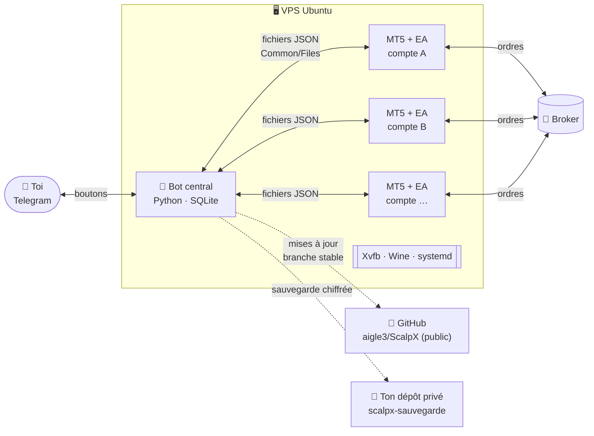
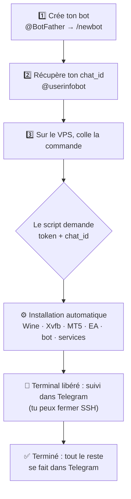
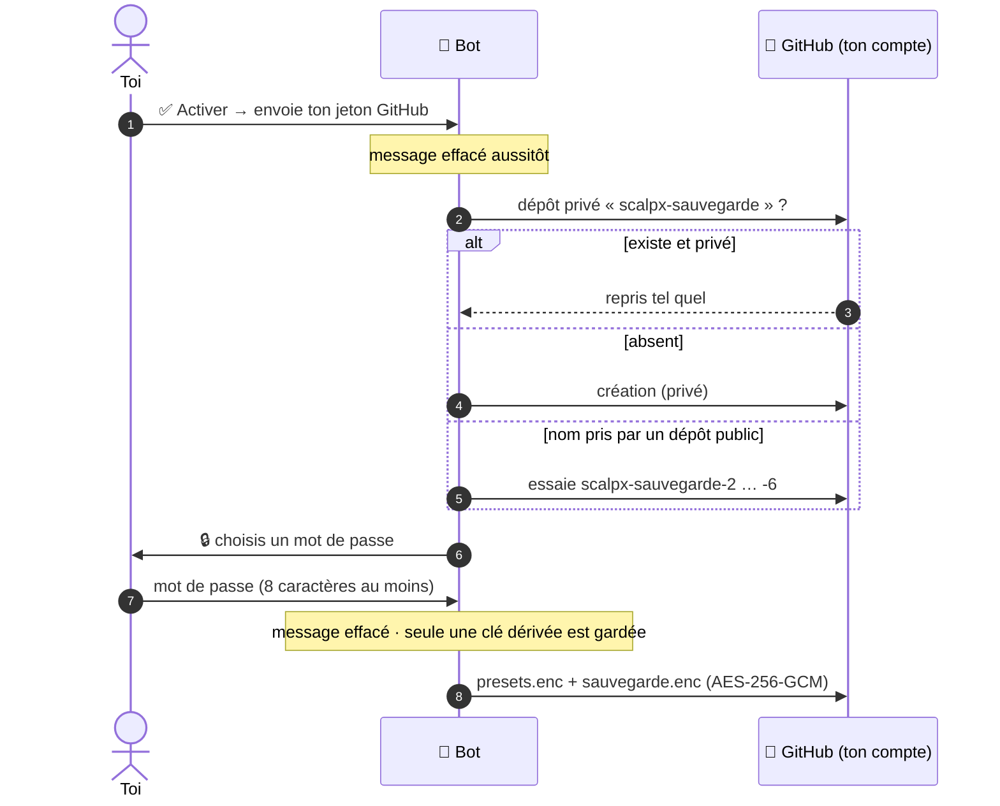
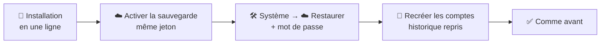
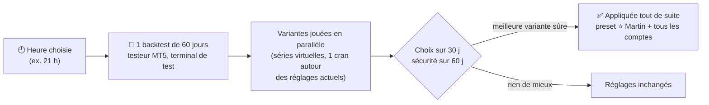
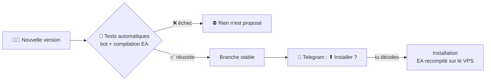

<div align="center">

# 📈 ScalpX

**Robot de trading multicompte pour MetaTrader 5, piloté entièrement depuis Telegram.**

Un seul VPS Ubuntu · un terminal MT5 par compte · un bot Telegram central · zéro commande à taper au quotidien.


[Installer en 1 ligne](#-installation-en-une-ligne) ·
[Premiers pas](#-premiers-pas-dans-telegram) ·
[Sauvegarde](#%EF%B8%8F-sauvegarde-privée-et-chiffrée) ·
[Mises à jour](#-mises-à-jour) ·
[FAQ](#-questions-fréquentes)

</div>

---

> [!WARNING]
> Le trading sur marge comporte un risque élevé de perte en capital. ScalpX est un outil : il ne garantit aucun gain.
> Commence toujours par un **compte démo**.

## ✨ En bref

| | |
|---|---|
| 🤖 **Un bot pour tous les comptes** | Ajoute, démarre, arrête, règle et surveille chaque compte MT5 par boutons Telegram. |
| 🖥 **Un seul serveur Ubuntu** | MT5 tourne sous Wine, sans écran (Xvfb) ; tout redémarre seul après un reboot. |
| ⚡ **Wine allégé** | ntsync (synchronisation par le noyau) activé si disponible, mise à jour Microsoft Edge coupée, écran virtuel léger (1024×600, 16 bits), chaque terminal attaché à un seul processeur (bien moins de temps système sous Wine) : moins de CPU. |
| 🏦 **Tous courtiers MT5** | RoboForex prêt d'office ; tout autre courtier s'ajoute depuis Telegram avec le lien de son installeur MT5 pour PC. |
| 🪶 **Terminaux légers** | Aucun affichage sur les graphiques MT5 (masqués) : tout se lit et se règle dans Telegram. |
| 💾 **Presets** | Réglages nommés (ex. « Martin ») appliqués à un ou plusieurs comptes, importés / exportés par fichier. |
| 🤖 **Optimiseur nocturne automatique** | Chaque nuit, il teste une catégorie de réglages sur l'historique et applique tout seul la meilleure variante sûre à « Martin » et à tous les comptes ; Telegram affiche ancienne → nouvelle valeur. |
| ⬆ **Mises à jour en un clic** | Chaque version testée est proposée dans Telegram ; rien ne s'installe sans ton accord. |
| ☁️ **Sauvegarde privée** | Dans un dépôt **privé de ton compte GitHub**, chiffrée par **ton** mot de passe. |
| 🔒 **Aucun secret sur le serveur à taper** | Jetons et mots de passe envoyés au bot sont **effacés de la conversation** aussitôt. |

## 🧭 Comment ça marche



- Le **bot ne se connecte jamais aux comptes** et les **EA ne parlent jamais à Telegram** : ils échangent par petits fichiers.
- Chaque compte a **son propre terminal MT5 portable** (copie de la BASE) : un plantage n'en touche qu'un.
- Le bot n'ouvre **aucun port** : il contacte Telegram et GitHub, rien n'entre.

## 🚀 Installation en une ligne

**Il te faut :** un VPS **Ubuntu 24.04 ou 26.04** (64 bits, 8 Go de RAM pour une dizaine de comptes), un accès root,
et un bot Telegram (créé en 1 minute avec [@BotFather](https://t.me/BotFather)).



<details open>
<summary><b>📋 Étape par étape</b></summary>

1. **Crée le bot Telegram** : ouvre [@BotFather](https://t.me/BotFather) → `/newbot` → choisis un nom → copie le
   **token** (`123456:ABC…`).
2. **Trouve ton chat_id** : ouvre [@userinfobot](https://t.me/userinfobot) → il t'affiche ton **Id** (un nombre).
3. **Envoie un message à ton bot** (n'importe lequel) pour qu'il ait le droit de t'écrire.
4. **Sur le VPS**, connecté en root :

   ```bash
   sudo bash -c "$(curl -fsSL https://raw.githubusercontent.com/aigle3/ScalpX/stable/linux/installer.sh)"
   ```

5. Réponds aux **deux seules questions** (token et chat_id) : le script les vérifie et t'envoie un premier message
   Telegram.
6. Le terminal rend la main aussitôt : l'installation continue **en arrière-plan** (15 à 40 min). **Tu peux fermer le
   terminal** et suivre tout dans Telegram. À la fin, le paquet téléchargé est supprimé tout seul.

</details>

> [!TIP]
> Aucun jeton GitHub n'est nécessaire : le dépôt est public. Relancer la même commande sur un serveur déjà installé
> ne demande que ce qui manque.

## 📲 Premiers pas dans Telegram

```
┌───────────────────────────────────────────┐
│ 📊 Tableau de bord : soldes, état, alertes │
│ ───────────────────────────────────────── │
│ [ 🧭 Filtres et positions ] [ 💸 Retraits ] │
│ [ 👥 Comptes ]            [ ⚡ Actions ]    │
│ [ 📈 Rapports ]           [ 🛠 Système 🔔 ] │
└───────────────────────────────────────────┘
```

| Je veux… | Dans Telegram |
|---|---|
| Ajouter un compte | 👥 Comptes → ➕ Nouveau compte (numéro, mot de passe, serveur) |
| Ajouter plusieurs comptes d'un coup | 👥 Comptes → 📄 Ajouter des comptes (fichier) : texte, une ligne `numéro:mot de passe:serveur` par compte (créés 2 par 2) |
| Appliquer mes réglages | ⚡ Actions → 💾 Presets → choisir le preset → 📤 Appliquer à tous les robots |
| Importer / exporter des presets | 💾 Presets → 📥 Importer (fichier ou texte) / 📤 Tout exporter ; un seul : 📤 Exporter (fichier) |
| Utiliser un autre courtier que RoboForex | 👥 Comptes → 🏦 Courtiers → ➕ : un nom de serveur (ex. `Exness-MT5Real8`) puis le lien « Télécharger pour PC » de son site |
| Installer une mise à jour | 🛠 Système → ⬆ Mises à jour (🔔 quand une version attend) |
| Voir le serveur | 🛠 Système → 🖥 Serveur (CPU, RAM, disque, processus) |
| Redémarrer le VPS | 🖥 Serveur → 🔁 Redémarrer le VPS (confirmation) |
| Lancer une commande sur le serveur (diagnostic, sans SSH) | 🖥 Serveur → 💻 Exécuter une commande (confirmée, utilisateur `scalpx`, 2 min max, sortie renvoyée) |
| Tout effacer sauf bot, BASE et presets | 🖥 Serveur → ♻️ Réinitialiser (double confirmation) |
| Tout désinstaller | 🖥 Serveur → 🧨 Tout désinstaller (3 confirmations, la dernière après 10 s) |

> [!IMPORTANT]
> **Un compte ne doit jamais tourner sur deux serveurs en même temps** : deux EA = ordres en double.

## ☁️ Sauvegarde privée et chiffrée

Juste après l'installation, le bot propose **« Activer la sauvegarde sur GitHub ? »** (aussi dans 🛠 Système → ☁️ Sauvegarde).



<details>
<summary><b>🔑 Créer le jeton GitHub (2 minutes)</b></summary>

**Option simple (recommandée)** — le bot crée le dépôt pour toi :
1. github.com → photo de profil → **Settings** → **Developer settings** → **Personal access tokens** → **Tokens (classic)**.
2. **Generate new token (classic)**, nom « ScalpX sauvegarde », expiration au choix, coche **`repo`**.
3. Copie le jeton (`ghp_…`) et envoie-le au bot.

**Option restreinte** — le jeton ne voit qu'un seul dépôt :
1. Crée toi-même un dépôt **privé** `scalpx-sauvegarde` (vide).
2. **Fine-grained tokens** → *Only select repositories* → ce dépôt → **Contents : Read and write**.
3. Envoie le jeton au bot.

</details>

| Quoi | Quand | Fichier |
|---|---|---|
| Presets | à chaque modification | `presets.enc` |
| Sauvegarde complète (historique, optimiseur, presets) | chaque nuit, ou ☁️ Sauvegarder maintenant | `sauvegarde.enc` |
| Copie locale de la base | chaque nuit (14 gardées) | `data/backups` sur le VPS |

> [!CAUTION]
> Le mot de passe n'est **jamais** enregistré. Sans lui, la sauvegarde est illisible : note-le dans un endroit sûr.

**📥 Importer** accepte tous les formats : fichier texte de presets, `presets.json`, sauvegarde complète,
chiffrés ou non (le mot de passe est demandé si besoin).

### 🔁 Repartir sur un serveur neuf



- **Jeton perdu ?** Normal : GitHub ne le montre qu'une fois. Crée simplement un **nouveau** jeton : le bot retrouve ton
  dépôt privé existant (même nom) et le reprend.
- **Rien n'est écrasé** : tant que ce serveur n'a pas restauré, le bot ne touche pas à la sauvegarde existante et propose
  **☁️ Restaurer** (avec le mot de passe de cette sauvegarde) ou **🔁 Remplacer**.
- Arrête d'abord les comptes sur l'ancien serveur (règle des deux serveurs ci-dessus).

## 🤖 Optimiseur nocturne



- **Cycle de 4 nuits** : 🧱 grille et lots → 📐 signal et TP → 🛡️ filtres → 🎯 objectif et créneaux.
- **Aucune validation à faire** : le changement est appliqué automatiquement, avec le détail dans Telegram et dans
  📈 Rapports → 🤖 Optimiseur automatique → 📜 Journal.
- **Garde-fous** : une variante n'est retenue que si elle ne perd jamais le compte (30 et 60 jours) et reste sous 90 % de
  drawdown ; un créneau n'est retiré qu'au-delà de 80 % de drawdown ; les coupures et le mode continu ne sont jamais touchés.
- **🔁 Série** : plusieurs optimisations enchaînées pour avancer plus vite ; **♻️ Réinitialiser** : retour au preset de
  base d'avant les optimisations.
- Il faut d'abord régler le **terminal de test** une fois (📈 Rapports → 🤖 Optimiseur automatique → 🔑 Terminal de test) ; l'heure se change avec 🕐.

## ⬆ Mises à jour



- **Rien ne s'installe tout seul** : le bot propose, tu choisis le moment.
- Déploiement de l'EA **compte par compte**, tout de suite, sur une sélection ou plus tard ; positions et ordres restent chez
  le broker avec leur TP et sont repris par le nouvel EA.
- Où : 🛠 Système → ⬆ Mises à jour.
- Si l'installation système change (Wine, services…), le bot affiche **🔔 🔧 Installation système** : un clic, sans mot de
  passe (droits limités du bot, voir [Sécurité](#-sécurité)).

## 🔒 Sécurité

| Principe | Concrètement |
|---|---|
| Accès Telegram verrouillé | Le bot ne répond qu'aux `chat_id` autorisés à l'installation. |
| Secrets jamais affichés | Jetons et mots de passe envoyés au bot sont effacés de la conversation. |
| Mot de passe jamais stocké | Seule une clé dérivée (scrypt) reste dans `.env`, lisible par le seul utilisateur `scalpx`. |
| Droits administrateur limités | Le bot n'a droit qu'à : redémarrer le VPS, ses 2 services, la mise à jour système et la désinstallation. |
| Aucun port ouvert | Le bot ne fait que des connexions sortantes (Telegram, GitHub). |
| Dépôt public sans données | Aucun jeton, numéro de compte ni réglage personnel dans ce dépôt. |

Conseil : sur le VPS, désactive la connexion SSH par mot de passe (clé uniquement).

## 🗂 Contenu du dépôt

```
ScalpX/
├── bot/                 🤖 bot Telegram central (Python, tests pytest)
├── ea/MQL5/Experts/     📈 EA ScalpX (MQL5) et ses modules SX_*.mqh
├── ea/MQL5/Presets/     ⚙️ préréglages MT5
├── linux/               🐧 installation Ubuntu (Wine, Xvfb, systemd)
└── docs/CHANGELOG.md    📝 historique de l'EA
```

Pour aller plus loin : [installation détaillée](linux/LISEZMOI.md) · [documentation du bot](bot/README.md) ·
[tests](bot/TESTS.md) · [historique de l'EA](docs/CHANGELOG.md).

## ❓ Questions fréquentes

<details>
<summary><b>Le bot ne répond pas après l'installation</b></summary>

Envoie-lui d'abord un message (Telegram interdit à un bot d'écrire le premier). Sur le VPS :
`sudo systemctl status scalpx-bot` et `sudo journalctl -u scalpx-bot -n 50`.
</details>

<details>
<summary><b>L'installation s'arrête ou bloque</b></summary>

Tout est noté dans `/var/log/scalpx-installation.log` (jamais de token dedans) : `sudo cat /var/log/scalpx-installation.log`.
Chaque étape réseau a une limite de temps et réessaie en IPv4 ; si Telegram ou GitHub est injoignable, le script le dit.
Utilise bien la commande ci-dessus (`sudo bash -c "$(curl …)"`) : l'ancienne forme `curl … | sudo bash` ne reçoit pas
le clavier sous Ubuntu 26.04 (les questions restent sans réponse).
</details>

<details>
<summary><b>« MT5 se prépare » : je ne peux pas créer de compte</b></summary>

À sa première ouverture, MT5 compile ~130 programmes MetaQuotes (plusieurs minutes à 100 % de CPU). Le bot le fait
une seule fois dans le dossier BASE, puis annonce **✅ MT5 prêt** : chaque compte créé ensuite démarre directement,
sans refaire ce travail.
</details>

<details>
<summary><b>Les terminaux s'arrêtent-ils pendant une mise à jour du bot ?</b></summary>

Non : le bot redémarre seul, les terminaux MT5 continuent de trader.
</details>

<details>
<summary><b>Et si le VPS redémarre ?</b></summary>

L'écran virtuel puis le bot démarrent tout seuls, et le bot relance chaque terminal.
</details>

<details>
<summary><b>J'ai perdu le mot de passe de la sauvegarde</b></summary>

Les sauvegardes chiffrées avec lui sont perdues. Sur le serveur actuel, 🛠 Système → ☁️ Sauvegarde → 🔒 Changer le mot de
passe : une nouvelle sauvegarde complète est envoyée aussitôt avec le nouveau.
</details>

<details>
<summary><b>Le jeton de sauvegarde a expiré</b></summary>

🛠 Système → 🔑 Clés et jetons → BACKUP_TOKEN : envoie le nouveau. Le dépôt et le mot de passe sont gardés.
</details>

---

<div align="center">
<sub>ScalpX · fait pour être piloté du bout des doigts 📱</sub>
</div>
